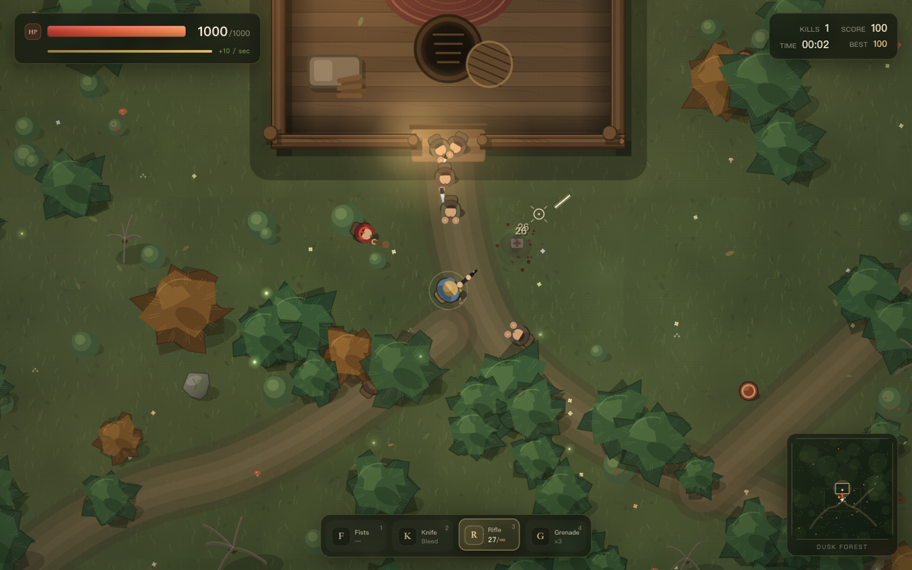

# Little Men · Dusk Forest

[中文](README.md) | **English**

A top-down endless survival shooter that runs in the browser. Little men keep pouring out of the dusk forest with fists and knives. Fight them with your fists, a hunting knife, a rifle and grenades — or climb into the hole in the shelter floor and let them tear each other apart.

**Single-file HTML · no dependencies · keyboard, mouse and touch · open and play.**

**Play online:** https://oomaidou.github.io/daxiaoren/

> If the link does not open, refresh the page or wait a minute. You can also download `index.html` and double-click it to play offline.



## The game

- You have **1000 HP** and regenerate **10 HP per second**.
- Little men have no health bars and keep respawning. They attack with fists and knives, and they also hurt each other.
- The shelter walls block bullets and there is only one south door. The **hole in the floor** (`E`) makes you untouchable while they fight above you.
- Red barrels explode and chain-react. Don't stand too close.
- Kills build a combo multiplier; your best score is stored in the browser.

## Controls

| Action | Keyboard / mouse | Touch |
| --- | --- | --- |
| Move | `WASD` / arrow keys | Drag on the left half |
| Aim | Mouse | Drag on the right half |
| Attack | Left mouse button (hold to keep firing) | Hold on the right half |
| Switch weapon | `1` `2` `3` `4` / mouse wheel / `Q` | **Swap** button |
| Reload | `R` | **Reload** button |
| Sprint | `Shift` | Push the joystick all the way |
| Dodge | `Space` | — |
| Enter / leave the hole | `E` | **Hole** button |
| Pause | `Esc` / `P` | Pause button (top left) |
| Mute | `M` | — |
| Language | `L` | `EN` / `中文` button |

## Weapons

| Weapon | Damage | Notes |
| --- | --- | --- |
| Fists | 18 | Free, strong knockback |
| Hunting knife | 48 + 8 bleed per second | Short melee arc, good up close |
| Rifle | 26 per shot, 30-round magazine | Infinite reserve, press `R` to reload |
| Grenade | 260 (falls off with distance) | Carry up to 5, can hurt you |

## The map

- **Shelter:** a log cabin with a campfire, bed, crates and a table. The south door is the only entrance.
- **The hole:** climb in and the little men lose track of you and start fighting each other. Press `E` again to climb out.
- **Barrels:** shoot them for an area explosion that can chain to nearby barrels.
- **Infighting:** little men attack each other when blocked, when they can't find you, or when they are the aggressive type. Knives and explosions can hit everyone.

## Project structure

- `index.html` — the built single-file version used by GitHub Pages
- `source/` — maintainable source: `index.html`, `style.css`, `game.js`
- `build.py` — inlines `source/` into the root `index.html`
- `preview.png` / `preview-en.png` — screenshots

After editing anything in `source/`, run:

```bash
python3 build.py
```

from the project root to rebuild `index.html`.

## Run locally

Double-click `index.html`, or start a local server in this folder:

```bash
python3 -m http.server 8000
```

Then open <http://localhost:8000>.

## Technical notes

- Canvas 2D rendering, no game engine or third-party libraries
- All gunshots, knife swings, explosions, footsteps and wind are synthesized with WebAudio
- Camera shake, particles, blood decals, floating damage numbers, adaptive camera
- Separate keyboard/mouse and touch controls
- Single file — the HTML is the whole game, easy to share or modify

## License

For fun and learning. All visuals and sounds are generated by code; there are no external assets.
