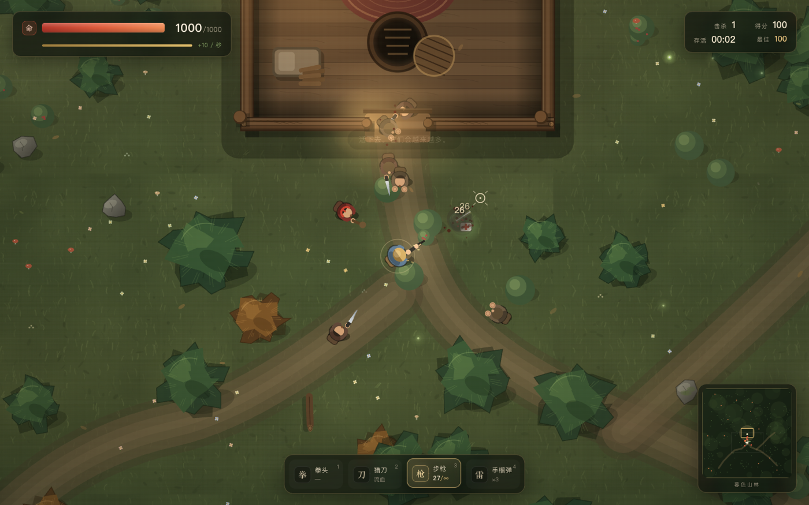

# 打小人 · 暮色山林

[中文](README.md) | [English](README.en.md)

一个跑在浏览器里的俯视角无尽生存射击小游戏：在暮色山林里，小人从树影中不断涌出来。用拳头、猎刀、步枪和手榴弹打退它们，或者钻进山腰庇护所的地洞，看它们在上面互相残杀。

打小人会掉**金币**。南门外的货摊能用金币换到粘液枪、流沙枪、加特林和大炮；还有**五台猎犬机器人**跟着你一起开火。

**单文件 HTML · 无第三方依赖 · 支持键鼠和触屏 · 打开即玩。**

游戏会自动识别浏览器语言：中文浏览器显示中文，其他语言显示英文；也可以在开始界面点 `EN / 中文`，或按 `L` 切换。英文界面截图见 [preview-en.png](preview-en.png)。



## 在线试玩

**https://oomaidou.github.io/daxiaoren/**

> 如果链接暂时打不开，刷新一下或等一分钟。也可以直接下载 `index.html`，双击本地游玩。

## 玩法

- 你有 **1000 点生命**，每秒自动回复 **10 点**。
- 小人没有血条，会不断补充，人数随时间变多；它们会用拳头和刀攻击你，也会误伤、内讧、互相残杀。
- 庇护所的木墙能挡子弹，只有一个南门。屋里的**地洞**按 `E` 钻进去可以完全避开攻击，在洞里继续回血。
- 红色油桶可以打爆，范围爆炸并引发连锁；小心别炸到自己。
- 连杀会累积倍率，最高分保存在浏览器本地。
- 打死小人会掉**金币**（连杀越高掉得越多）。走到南门外的货摊按 `E`，可以花金币买新武器。
- **五台猎犬机器人**从开局就跟着你，自动朝 620 范围内的敌人开火，不需要操作。

## 操作

| 操作 | 键鼠 | 触屏 |
| --- | --- | --- |
| 移动 | `WASD` / 方向键 | 左半屏拖动 |
| 瞄准 | 鼠标 | 右半屏拖动 |
| 攻击 | 鼠标左键（按住连发） | 右半屏按住 |
| 换武器 | `1` – `8` / 滚轮 / `Q` | 右下「换」 |
| 装弹 | `R` | 右下「弹」 |
| 冲刺 | `Shift` | 摇杆推到底自动冲刺 |
| 翻滚 | `空格` | — |
| 地洞 | `E`（靠近地洞时） | 右下「洞」 |
| 货摊 | `E` / `B`（靠近货摊时） | 右下「店」 |
| 暂停 | `Esc` / `P` | 左上暂停键 |
| 静音 | `M` | — |

## 武器数值

| 武器 | 伤害 | 说明 |
| --- | --- | --- |
| 拳头 | 18 | 无消耗，击退强 |
| 猎刀 | 48 + 每秒 8 点流血 | 近战扇形，适合贴脸 |
| 步枪 | 26 / 发，30 发弹匣 | 备弹无限，按 `R` 装弹 |
| 手榴弹 | 260（随距离衰减） | 最多携带 5 枚，会炸伤自己 |
| 粘液枪 | 13 / 发，24 发弹匣 | 商店 90 金币。命中把小人粘在原地 2.4 秒，溅射范围内也会变慢 |
| 流沙枪 | 16 / 发，12 发弹匣 | 商店 170 金币。命中后小人往下陷，0.85 秒后整只被埋掉（秒杀） |
| 加特林 | 17 / 发，220 发弹匣 | 商店 320 金币。按住越打越快，适合压人群 |
| 大炮 | 205（范围 150） | 商店 460 金币。6 发弹仓，炮弹落地炸开一片，自己也会被炸到 |

## 商店与金币

- 每打死一个小人掉 **2 – 5 金币**，连杀倍率会让金币一起变多；金币一局一清空。
- 货摊在庇护所南门外东侧，走近按 `E`（或 `B`）打开；买下的武器会立刻装备，之后用 `5` – `8` 或滚轮切换。
- 商店界面里按 `1` – `4` 可以直接买对应的四把武器，`Esc` / `E` 离开。
- 屏幕右上角显示当前金币；打不开商店时先确认自己站在摊位旁边。

## 猎犬机器人

- 开局就有 5 台，围着你转，自动索敌、自动开火，单发 15 伤害、射速约 0.5 – 0.85 秒。
- 它们不会挡住你，也不会误伤你；打死的敌人一样算你的击杀和金币。
- 同伴在躲进地洞、奔跑、被围住时都会继续工作。

## 地图机制

- **庇护所**：山腰的木屋，有篝火、床铺、木箱和桌子；南门是唯一入口。
- **货摊**：南门外东侧，红白条纹的棚子，挂着一盏灯笼和一块「货」字招牌；走近会有一圈提示。
- **地洞**：钻进地洞后小人会失去目标，转而互相攻击；再按一次 `E` 爬出来。
- **油桶**：打爆后产生范围爆炸，能连锁引爆附近的桶。
- **内讧**：小人被挡住、找不到你，或本身就是好斗类型时，会攻击同伴；刀和爆炸都会误伤。

## 项目结构

- `index.html` — 单文件构建版，GitHub Pages 使用的版本
- `source/` — 可维护源码：`index.html`、`style.css`、`game.js`
- `build.py` — 把 `source/` 内联成根目录的 `index.html`
- `preview.png` / `preview-en.png` — 中英文截图

修改 `source/` 里的文件后，在项目根目录运行：

```bash
python3 build.py
```

就会重新生成 `index.html`。

## 本地运行

直接双击 `index.html` 即可；也可以在当前目录启动一个本地服务器：

```bash
python3 -m http.server 8000
```

然后访问 <http://localhost:8000>。

## 实现

- 原生 Canvas 2D 渲染，没有使用任何游戏引擎或第三方库
- WebAudio 实时合成枪声、刀声、爆炸、脚步和环境风声
- 自适应镜头、粒子、血迹、屏幕震动、伤害数字
- 桌面与触屏双套操作
- 五个 AI 同伴：编队跟随、避障、索敌、自动开火
- 局内经济：击杀掉金币 → 地图货摊买武器
- 单文件即源码，方便直接分享和修改

## License

仅供娱乐和学习使用。游戏中的图片、音效均由代码实时生成，不包含外部素材。
